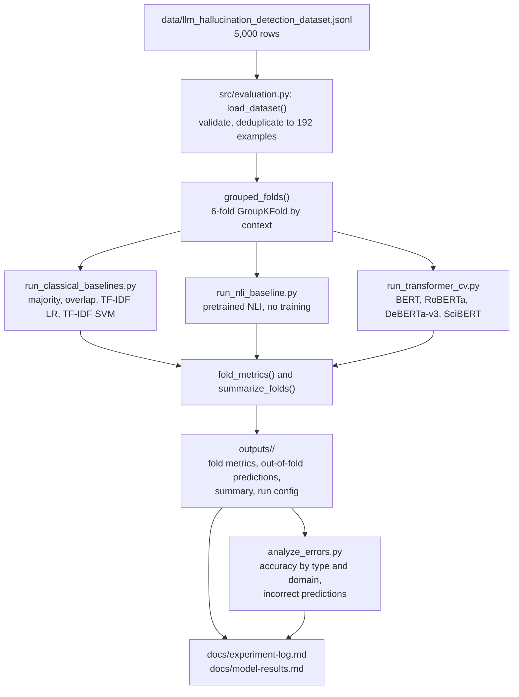
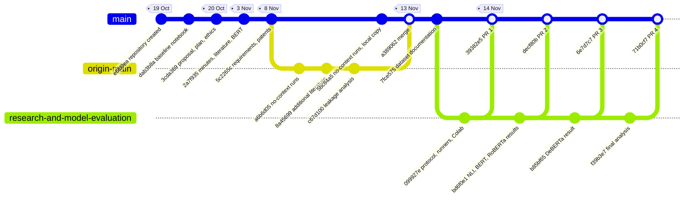

# LLM Hallucination Detection — Project Reference

COSC 497 Senior Design Project I, Khalifa University
Supervisor: Dr. U Zeyar Aung
Team: Shahad Aljasmi, Wadha Msaiqer, Mouza Alshehhi, Maram Alkatheeri

This document describes the repository as of commit `71b0cf7` (14 November 2026, 70 commits on `main`). It covers what the system does, how it is built, what every file is for, how to run it, and how the repository got to its current state.

> Historical snapshot: the file inventory, commit counts and authorship tables below describe commit `71b0cf7` on 14 November 2026. Later additions include `docs/metrics-ablations.md`. Repository maintenance on 19 November added this reference, marked the exploratory notebooks and early specifications as historical, and pointed the Colab notebook to the main repository. The section 11 list records issues found in the original snapshot; some are now addressed.

## Contents

1. [What the project does](#1-what-the-project-does)
2. [Results at a glance](#2-results-at-a-glance)
3. [System architecture](#3-system-architecture)
4. [Repository layout](#4-repository-layout)
5. [Dataset](#5-dataset)
6. [Evaluation protocol](#6-evaluation-protocol)
7. [Setup](#7-setup)
8. [Running the experiments](#8-running-the-experiments)
9. [Project history](#9-project-history)
10. [Git history diagram](#10-git-history-diagram)
11. [Known inconsistencies](#11-known-inconsistencies)
12. [Limitations and future work](#12-limitations-and-future-work)

## 1. What the project does

The system decides whether an AI-generated answer is supported by a given context passage.

- **Input:** a `context` passage and a candidate `response` (optionally the `prompt` as well).
- **Output:** one label, `faithful` or `hallucinated`.

Example: with the context "Tokyo is the capital of Japan", the response "Japan's capital is Tokyo" is faithful and "Japan's capital is Kyoto" is hallucinated.

The project compares three families of detector on the same data and the same folds:

| Family | Models | Needs training |
|---|---|---|
| Classical baselines | Majority class, word overlap, TF-IDF + logistic regression, TF-IDF + linear SVM | Only the TF-IDF models |
| Fine-tuned pair classifiers | BERT, RoBERTa, DeBERTa-v3 (SciBERT supported but not run) | Yes, one model per fold |
| Pretrained NLI | `MoritzLaurer/DeBERTa-v3-base-mnli-fever-anli` | No |

## 2. Results at a glance

All numbers are from six-fold cross-validation grouped by context on the 192 unique examples. Each example is predicted exactly once, by a model that never saw its context.

| Model | Accuracy | Weighted F1 (mean ± std over folds) | Hallucinated recall | Errors (of 192) |
|---|---:|---:|---:|---:|
| Pretrained DeBERTa-v3 NLI | 1.000 | 1.000 ± 0.000 | 1.000 | 0 |
| Fine-tuned DeBERTa-v3 | 0.938 | 0.937 ± 0.070 | 0.875 | 12 |
| Fine-tuned RoBERTa | 0.896 | 0.892 ± 0.100 | 0.792 | 20 |
| Word overlap | 0.896 | 0.885 ± 0.169 | 0.792 | — |
| Fine-tuned BERT | 0.771 | 0.739 ± 0.209 | 0.583 | 44 |
| TF-IDF + logistic regression | 0.604 | 0.569 ± 0.101 | 0.792 | — |
| TF-IDF + linear SVM | 0.562 | 0.533 ± 0.105 | 0.708 | — |
| Majority class | 0.500 | 0.333 ± 0.000 | 0.000 | — |

Main findings (from `docs/final-analysis.md`):

- Framing the task as natural-language inference fits best. The pretrained NLI model needs no project training and classifies all 192 examples correctly.
- Among trained models, DeBERTa-v3 is strongest and most stable across folds.
- BERT is unstable on unseen contexts; in one fold it labelled every hallucination as faithful.
- The remaining errors of the fine-tuned models are almost all missed hallucinations that copy the context and change one fact or date.

The perfect NLI score describes this small synthetic dataset only. It is not a claim about real-world hallucination detection.

## 3. System architecture

### 3.1 Pipeline



### 3.2 Components

**Shared library — `src/evaluation.py`.** Every experiment script imports this module, which is what keeps the results comparable.

| Function | Responsibility |
|---|---|
| `load_dataset(path)` | Reads the JSONL file, checks that `prompt`, `context`, `response` and `label` exist, rejects unknown labels and conflicting duplicates, drops exact duplicate triples, and adds `label_id` (faithful = 0, hallucinated = 1). |
| `grouped_folds(frame, n_splits=6)` | Yields train and test indices from `GroupKFold` with `context` as the group, so a context never appears on both sides. |
| `build_input(frame, condition)` | Builds the single-string input for the classical models under one of four input conditions. |
| `fold_metrics(y_true, y_pred)` | Returns accuracy, weighted F1, macro F1, per-class precision, recall, F1 and support, and the confusion-matrix counts. |
| `summarize_folds(metrics)` | Mean and sample standard deviation of every numeric metric across folds. |

**Classical runner — `experiments/run_classical_baselines.py`.** Runs four models per fold. The word-overlap rule is not trained: it labels a response hallucinated when fewer than 60% of its words appear in the context. The TF-IDF models use unigrams and bigrams with sublinear term frequency and balanced class weights.

**NLI runner — `experiments/run_nli_baseline.py`.** Scores every example once with the pretrained checkpoint, using the context as premise and the response as hypothesis. The three NLI classes are reduced to two: entailment probability of at least 0.5 means faithful, anything else (contradiction or neutral) means hallucinated. No training happens, so the folds are used only to report per-fold metrics on the same splits as the other models.

**Transformer runner — `experiments/run_transformer_cv.py`.** For each of the six folds it:

1. holds out 20% of the training contexts as a validation set (`GroupShuffleSplit`, so validation contexts are also unseen);
2. fine-tunes a fresh two-label model for up to five epochs, evaluating each epoch;
3. stops early after two epochs without improvement and restores the checkpoint with the best validation weighted F1;
4. predicts the held-out test fold and records training and inference time;
5. deletes the fold checkpoint unless `--keep-checkpoints` is set.

Checkpoints are written to the system temporary folder rather than the output folder, so that Colab runs do not write large files to Google Drive. The script also adapts to both old and new argument names in the Transformers library.

**Error analysis — `experiments/analyze_errors.py`.** Reads any out-of-fold prediction file and writes accuracy by model, by hallucination type and by domain, confusion counts, the list of incorrect predictions, and a Markdown report. Metadata such as hallucination type is used here only, never as a model input.

### 3.3 Design decisions

| Decision | Reason | Where recorded |
|---|---|---|
| Remove exact duplicate triples before splitting | 4,808 of the 5,000 rows repeat an existing prompt, context and response | `docs/dataset.md` |
| Group folds by context | Each context has eight related examples; the random split reused contexts for all 39 test rows and prompts for 33 of them | `data_leakage_analysis.ipynb`, `docs/experimental-protocol.md` |
| Six folds | 24 contexts divide evenly into six groups of four | `docs/experimental-protocol.md` |
| Weighted F1 as the primary metric | Matches the SciHal25 shared task the project follows | `docs/paper-matrix.md` |
| Never use `hallucination_type`, `factuality_score`, `confidence_score` as inputs | They reveal the label | `docs/dataset.md` |
| Treat NLI neutral as hallucinated | A response that is not supported is not faithful, even if it does not contradict the context | `experiments/run_nli_baseline.py` |
| Do not commit outputs or model weights | They are large and reproducible from the scripts | `.gitignore` |
| Stop at four transformer approaches | Remaining time was better spent on analysis than on SciBERT | `docs/final-analysis.md` |

## 4. Repository layout

```text
.
├── README.md
├── requirements.txt
├── .gitignore
├── src/
│   └── evaluation.py
├── experiments/
│   ├── run_classical_baselines.py
│   ├── run_nli_baseline.py
│   ├── run_transformer_cv.py
│   ├── analyze_errors.py
│   └── colab_transformer_experiments.ipynb
├── data/
│   ├── llm_hallucination_detection_dataset.jsonl
│   ├── data_dictionary.csv
│   ├── DATA_README.md
│   └── LICENSE
├── docs/                  (19 Markdown files, listed below)
├── baseline.ipynb
├── bert_roberta.ipynb
└── data_leakage_analysis.ipynb
```

### 4.1 Code and configuration

| File | Purpose | First added | Author |
|---|---|---|---|
| `src/evaluation.py` | Shared loading, folding, input building and metrics | 14 Nov | Wadha667 |
| `experiments/run_classical_baselines.py` | Four classical baselines under the grouped protocol | 14 Nov | Wadha667 |
| `experiments/run_nli_baseline.py` | Pretrained NLI detector | 14 Nov | Wadha667 |
| `experiments/run_transformer_cv.py` | Fine-tuning with grouped cross-validation | 14 Nov | Wadha667 |
| `experiments/analyze_errors.py` | Error breakdown from prediction files | 14 Nov | Wadha667 |
| `experiments/colab_transformer_experiments.ipynb` | Runs any experiment on a Colab GPU and saves results to Drive | 14 Nov | Wadha667 |
| `requirements.txt` | Python dependencies | 14 Nov | Wadha667 |
| `.gitignore` | Excludes caches, virtual environments, outputs, checkpoints and `.env` | 14 Nov | Wadha667 |
| `README.md` | Short project summary and run commands | 19 Oct, last changed 14 Nov | user-shad, Shahad Aljasmi, Wadha667 |

### 4.2 Notebooks (earlier exploratory work)

These notebooks came before the grouped protocol. They are kept as a record of how the method developed. Their scores use a single split and are not comparable with section 2.

| File | What it shows | Added | Author |
|---|---|---|---|
| `baseline.ipynb` | Loads the data, builds the word-overlap rule, finds the duplicate rows, trains TF-IDF models on a 39-row random test split | 19–20 Oct | Shahad Aljasmi |
| `bert_roberta.ipynb` | First BERT and RoBERTa runs on the 39-row split, with and without context | 3 Nov, updated 8 Nov | Shahad Aljasmi |
| `data_leakage_analysis.ipynb` | Shows that the random split shares 33 question and context groups between training and test, then re-scores the baselines on a grouped split | 10 Nov | mouzaa1004-maker |

### 4.3 Data

| File | Purpose | Added |
|---|---|---|
| `data/llm_hallucination_detection_dataset.jsonl` | The dataset, 5,000 JSON lines, 2.7 MB | 19 Oct |
| `data/data_dictionary.csv` | One-line description of each column | 19 Oct |
| `data/DATA_README.md` | The dataset's own description from Kaggle | 19 Oct |
| `data/LICENSE` | MIT licence of the dataset | 19 Oct |

### 4.4 Documentation

| File | Content | Added | Author |
|---|---|---|---|
| `docs/proposal.md` | Project proposal | 20 Oct | Shahad Aljasmi |
| `docs/progress-report.md` | First progress report | 20 Oct | Shahad Aljasmi |
| `docs/gantt.md` | Work plan by week | 20 Oct | user-shad |
| `docs/standards-ethics.md` | Professional ethics and standards | 20 Oct | user-shad |
| `docs/decisions.md` | Topic, dataset and early method decisions | 20 Oct | user-shad |
| `docs/minutes.md` | Supervisor meetings of 14 Sep, 21 Sep and 26 Oct | 3 Nov | Shahad Aljasmi |
| `docs/literature-review.md` | Review of SciHal hallucination detection work | 3 Nov | Shahad Aljasmi |
| `docs/design-cost.md` | Design options and cost | 3 Nov | Shahad Aljasmi |
| `docs/handbook-checklist.md` | Repository checked against the SDP I assessment forms | 3 Nov | Shahad Aljasmi |
| `docs/Requirements.md` | Requirements, specification, research questions | 8 Nov, updated 13 Nov | user-shad |
| `docs/patent-search.md` | Patent search | 8 Nov | user-shad |
| `docs/additional-literature.md` | Additional related papers | 9 Nov | M-261 |
| `docs/dataset.md` | Dataset description, quality checks, grouping | 13 Nov | user-shad |
| `docs/paper-matrix.md` | Related work mapped to reproducible experiments | 14 Nov | Wadha667 |
| `docs/experimental-protocol.md` | Evaluation rules for every model | 14 Nov | Wadha667 |
| `docs/running-experiments.md` | Step-by-step run guide | 14 Nov | Wadha667 |
| `docs/experiment-log.md` | One entry per experiment, EXP-001 to EXP-005 | 14 Nov | Wadha667 |
| `docs/model-results.md` | Full result tables and interpretation | 14 Nov | Wadha667 |
| `docs/final-analysis.md` | Final comparison, error analysis, limitations | 14 Nov | Wadha667 |

## 5. Dataset

Source: the "LLM Hallucination Detection" dataset on Kaggle (`mmumairkhattak/llm-hallucination-detection-nlp-and-ai-safety`), named by the supervisor on 21 September 2026 after the original competition data proved hard to download. It is synthetic, English, and MIT-licensed.

| Property | Value |
|---|---|
| Rows in the file | 5,000 |
| Unique prompt, context, response triples | 192 |
| Labels after deduplication | 96 faithful, 96 hallucinated |
| Labels before deduplication | 3,369 faithful, 1,631 hallucinated |
| Distinct contexts | 24 |
| Examples per context | 8 (four prompt wordings, each with one faithful and one hallucinated response) |
| Domains | Science, history, technology, geography, general medicine, general law, business, general finance |

Columns used as model input: `prompt`, `context`, `response`.
Target: `label`.
Used only for error analysis: `hallucination_type`, `domain`, `task_type`, `difficulty`.
Never used: `factuality_score`, `confidence_score`.

## 6. Evaluation protocol

The full rules are in `docs/experimental-protocol.md`. In short:

- Remove exact duplicates, then split with six-fold `GroupKFold` on `context`. Each fold tests on four unseen contexts (32 examples).
- All models use the same folds. Fold numbers are saved with every prediction.
- Report weighted F1 (primary), macro F1, accuracy, per-class precision, recall and F1, confusion counts, and mean and standard deviation over folds.
- Hyperparameters are never chosen using the test fold. Transformers use an inner validation split of the training contexts.
- Fixed seed: 42.

Input conditions supported by the classical and transformer runners:

| `--condition` | Model sees | Role |
|---|---|---|
| `context_response` | context and response | Primary result |
| `prompt_context_response` | prompt, context and response | Secondary |
| `prompt_response` | prompt and response | No-context ablation |
| `response_only` | response | Shortcut check |

Only `context_response` results under the grouped protocol have been recorded so far.

## 7. Setup

Requirements: a recent Python 3 (the repository does not pin a version; 3.10 or newer is a safe choice for the listed dependencies). A GPU is recommended for the fine-tuned models; everything else runs on a CPU.

```bash
git clone https://github.com/user-shad/llm-hallucination-detection.git
cd llm-hallucination-detection

python -m venv .venv
source .venv/bin/activate          # Windows PowerShell: .venv\Scripts\Activate.ps1

python -m pip install --upgrade pip
python -m pip install -r requirements.txt
```

Dependencies (`requirements.txt`): numpy, pandas, scikit-learn, joblib, torch, transformers, accelerate, notebook.

The dataset is already in the repository. Transformer checkpoints download from the Hugging Face Hub on first use and are not committed.

## 8. Running the experiments

Run every command from the repository root. Each script writes to the folder given by `--output-dir`; the `outputs/` folder is ignored by Git.

### 8.1 Classical baselines (seconds, CPU)

```bash
python experiments/run_classical_baselines.py --output-dir outputs/classical
```

Writes `classical_fold_metrics.csv`, `classical_oof_predictions.csv`, `classical_summary.csv`, `classical_run_config.json`.

### 8.2 Pretrained NLI (about 1.4 seconds of inference on a Colab GPU)

```bash
python experiments/run_nli_baseline.py --output-dir outputs/nli_baseline
```

Writes `fold_metrics.csv`, `oof_predictions.csv` (with the entailment probability for every example), `summary.csv`, `run_config.json`.

Options: `--checkpoint`, `--batch-size` (default 16), `--max-length` (default 256).

### 8.3 Fine-tuned transformers (GPU recommended)

```bash
python experiments/run_transformer_cv.py --model bert    --output-dir outputs/bert
python experiments/run_transformer_cv.py --model roberta --output-dir outputs/roberta
python experiments/run_transformer_cv.py --model deberta --output-dir outputs/deberta
```

Each command trains six models. Recorded training time on Colab: about 5.6 minutes each for BERT and RoBERTa, about 13.2 minutes for DeBERTa-v3.

| Option | Default | Meaning |
|---|---|---|
| `--model` | required | `bert`, `roberta`, `deberta` or `scibert` |
| `--checkpoint` | per model | Override the Hugging Face checkpoint |
| `--condition` | `context_response` | Input condition (section 6) |
| `--learning-rate` | `2e-5` | |
| `--batch-size` | `8` | The recorded BERT and RoBERTa runs used 16 |
| `--epochs` | `5` | Maximum; early stopping patience is 2 |
| `--weight-decay` | `0.01` | |
| `--max-length` | `256` | Tokens |
| `--seed` | `42` | |
| `--checkpoint-dir` | system temp folder | Where fold checkpoints are written |
| `--keep-checkpoints` | off | Keep checkpoints after prediction |

Default checkpoints: `bert-base-uncased`, `roberta-base`, `microsoft/deberta-v3-base`, `allenai/scibert_scivocab_uncased`.

Writes `fold_metrics.csv`, `oof_predictions.csv` (with both class probabilities), `summary.csv`, `run_config.json`.

### 8.4 Ablation example

```bash
python experiments/run_transformer_cv.py --model bert --condition response_only --output-dir outputs/bert_response_only
```

### 8.5 Error analysis

```bash
python experiments/analyze_errors.py \
  --predictions outputs/deberta/oof_predictions.csv \
  --output-dir outputs/deberta_error_analysis
```

Writes `accuracy_by_model.csv`, `accuracy_by_hallucination_type.csv`, `accuracy_by_domain.csv`, `confusion_counts.csv`, `incorrect_predictions.csv`, `error_analysis.md`.

### 8.6 Google Colab

Open `experiments/colab_transformer_experiments.ipynb`, set the runtime to a T4 GPU, and run the cells in order. The notebook clones the project, installs the dependencies, mounts Google Drive for results, runs the model chosen in the `MODEL` field, and then runs the error analysis. Run one model per session.

### 8.7 Recording a result

1. Confirm all six folds finished and check `run_config.json`.
2. Run the error analysis.
3. Add an entry to `docs/experiment-log.md` and the aggregate row to `docs/model-results.md`.

## 9. Project history

Dates are commit dates from the Git log. Supervisor meetings are from `docs/minutes.md`.

| Phase | Dates | What happened | Commits |
|---|---|---|---:|
| 0. Topic and dataset | 9–21 Sep | Topic changed to LLM Hallucination Detection; first two supervisor meetings; Kaggle dataset chosen | 0 |
| 1. First baseline | 19–20 Oct | Repository created; dataset added; `baseline.ipynb` built step by step (overlap rule, duplicates found, TF-IDF models); proposal, progress report, plan, ethics and decisions added | 22 |
| 2. Course documents and first transformers | 3 Nov | Meeting minutes, literature review, design and cost note, handbook checklist; first BERT and RoBERTa runs in `bert_roberta.ipynb` | 5 |
| 3. Requirements and leakage | 8–13 Nov | Requirements and patent search; no-context runs; additional literature (9 Nov); leakage analysis showing the random split was optimistic (10 Nov); dataset documentation and grouping strategy (13 Nov) | 14 |
| 4. Grouped protocol and final experiments | 14 Nov | Paper matrix and protocol; shared evaluation module; classical, NLI and transformer runners; Colab notebook; results for all five experiments; final analysis. Delivered through pull requests 1 to 4 | 29 |

How the method changed:

1. **Word-overlap rule on a random split (October).** Scored 97% on 39 test rows, which made it the "current method" at the time.
2. **Leakage found (10 November).** Related examples were on both sides of that split, so the 97% was optimistic.
3. **Grouped six-fold protocol (14 November).** Under it, word overlap drops to 0.885 weighted F1, and the comparison in section 2 becomes the reported result.

### Commits by author

| Author name in Git | Commits | Of which merges | Main contributions |
|---|---:|---:|---|
| Wadha667 | 29 | 4 | Protocol, shared module, all experiment scripts, Colab notebook, results and final analysis |
| Shahad Aljasmi | 24 | 1 | Dataset, baseline and BERT/RoBERTa notebooks, proposal, minutes, literature review, design note, checklist |
| user-shad | 15 | 0 | Repository setup, plan, ethics, decisions, requirements, patent search, dataset documentation |
| M-261 | 1 | 0 | `docs/additional-literature.md` |
| mouzaa1004-maker | 1 | 0 | `data_leakage_analysis.ipynb` |

"Shahad Aljasmi" and "user-shad" are two author names used by the repository owner (local Git and the GitHub web editor).

## 10. Git history diagram

Simplified graph. Each node stands for a group of commits; the ID is the last commit of the group.



The same history as plain text (newest first):

```text
*   71b0cf7  14 Nov  Merge PR #4
|\
| * f39b3e7          docs: add final model analysis
| * a0dacbd          docs: close experiment phase
* | 6e7d7c7  14 Nov  Merge PR #3
|\|
| * b85bf65          docs: record DeBERTa result
* | decf80b  14 Nov  Merge PR #2
|\|
| * bd6f0e1          docs: record RoBERTa result
| * 660f921          docs: record BERT result
| * ...              6 commits: Colab fixes, NLI label fix, NLI result
* | 39382e5  14 Nov  Merge PR #1
|\|
| * 099927e          experiment: add Colab GPU runner
| * ...              13 commits: protocol, evaluation module, runners, run guide
|/
* 7fce575    13 Nov  Document related examples and grouping strategy
* ...                4 commits: requirements and dataset documentation
*   a389062  13 Nov  Merge remote main into local main
|\
| * c67d100  10 Nov  Add data leakage analysis and grouped baseline evaluation
| * 8a45699   9 Nov  Create additional-literature.md
| * a6b6d05   8 Nov  Record BERT and RoBERTa trained on question and answer only
* | 5bc84a5   8 Nov  (same change, local copy)
|/
* 5c2265c     8 Nov  Update README.md
* ...                3 commits: requirements, patent search
* 2a7f935     3 Nov  Record BERT, RoBERTa and the no-context test
* ...                4 commits: minutes, literature review, design, checklist
* 3cda369    20 Oct  project decisions
* ...                20 commits: baseline notebook, proposal, plan, ethics
* e6fd9ea    19 Oct  Initial commit
```

To reproduce the full graph locally:

```bash
git log --graph --date=short --pretty='%h %ad %an: %s'
```

Branching model in use: one feature branch (`research-and-model-evaluation`, in a fork) merged into `main` through four pull requests. All earlier work was committed directly to `main`.

## 11. Known inconsistencies

Items in the repository that no longer match its final state. None affects the reported results.

| Item | Problem | Suggested fix |
|---|---|---|
| `docs/Requirements.md` | Still says the score is reported on 39 random test rows and that the word check is the current method (0.974) | Update to the grouped protocol and the NLI detector, or mark the section as historical |
| `docs/decisions.md` | Same: describes the 20% random test split and the word check as the method | Add dated entries for the grouped protocol and the final model choice |
| `docs/gantt.md` | Plan dated 20 October; shows only two meetings and no experiment phase | Update to what was actually done |
| `docs/minutes.md` | Last meeting recorded is 26 October | Add later meetings |
| `experiments/colab_transformer_experiments.ipynb` | Clones the fork `Wadha667/llm-hallucination-detection`, branch `research-and-model-evaluation`, not this repository's `main` | Point `REPOSITORY` and `BRANCH` at the main repository |
| `baseline.ipynb`, `bert_roberta.ipynb` | Use the random split; scores conflict with section 2 if read on their own | Add a first cell stating they are superseded, or move them to a `notebooks/legacy/` folder |
| `docs/final-analysis.md` vs. `run_transformer_cv.py` | Analysis says BERT and RoBERTa used batch size 16; the script default is 8 | State the batch size in the run command, or change the default |
| Commit `a389062` | Merge message contains Git's unedited template text | Cannot be changed without rewriting history; leave it and avoid in future |
| Commits `a6b6d05` and `5bc84a5` | Same change committed twice (local and remote), which caused that merge | Run `git pull` before committing |
| Repository root | No licence file for the project code (`data/LICENSE` covers the dataset only) | Add a root `LICENSE` if the team wants the code licensed |
| Input-condition ablations | Supported by the scripts but no grouped-protocol results recorded | Run and log them, or state they were not run |

## 12. Limitations and future work

- The dataset is synthetic and small: 192 unique examples over 24 contexts.
- Fine-tuned models were trained with one seed.
- No independent dataset has been evaluated, so nothing here shows real-world performance.
- Runtime figures come from one Colab session.
- The detector needs a context. A version that works from the question and answer alone is a stated later requirement.

Planned next steps recorded in the repository: evaluation on an independently collected dataset first, then multiple seeds, calibrated confidence scores, and explanations that point to the unsupported part of a response. SciBERT is supported by the runner but was not run.
